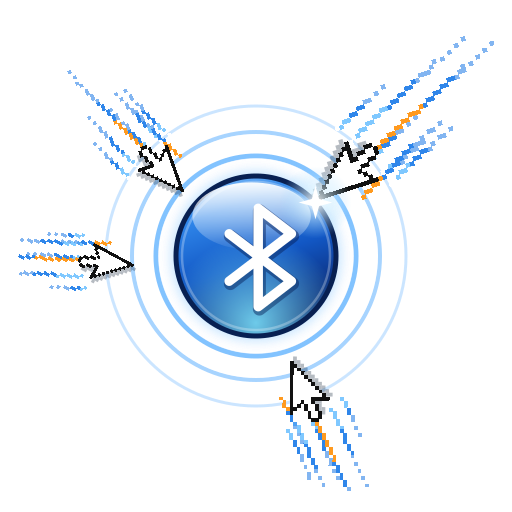
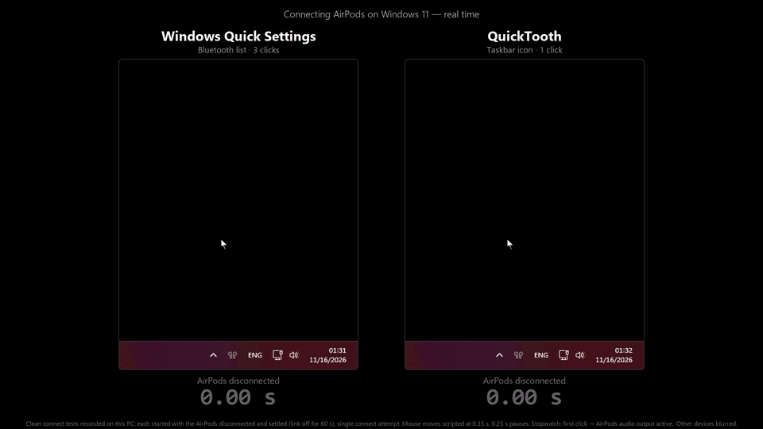

<p align="center">
  
</p>

<h1 align="center">QuickTooth</h1>

<p align="center">
  Connect or disconnect your AirPods from the Windows 11 taskbar with one click, in a second or two.
</p>

<p align="center">
  
  <br>
  <sub><a href="docs/demo.mp4">Full-quality video (MP4)</a></sub>
</p>

| Connecting AirPods | Clicks | From click to sound ready |
| --- | :-: | --: |
| Windows: Quick Settings → Bluetooth → your AirPods | 3 | **16.27 s** |
| QuickTooth: the AirPods icon in the taskbar | 1 | **1.22 s** |

<sub>A real recording on one Windows 11 PC with AirPods Pro 3. Before each run the AirPods had been disconnected and left alone for 60 seconds. The stopwatch runs from the first click until Windows reports the AirPods' audio output as ready. Your times will vary.</sub>

## Why it's so much faster

AirPods talk to your PC over **two separate Bluetooth connections**:

- **Music** (A2DP): the stereo audio you listen to.
- **Hands-free** (HFP): the microphone, for calls.

On current Windows 11, the music connection doesn't start until the hands-free one is up as well; every connection in our logs behaved this way. That's where the time goes: when you connect the usual way, the hands-free connection can take 10–20 seconds to come up. In one of our tests Windows even gave up ("Couldn't connect") and only succeeded on a second try.

**QuickTooth asks for both connections at the same moment**, so nothing waits on anything else and both come up together.

Asking for both is what makes the difference. We measured it directly: when QuickTooth asked only for the music connection, a reconnect took 9 s, 15 s, or didn't finish at all within 40 s. Asking for both, the same reconnect took 1–3 s every time.

Two smaller things help as well:

- **One click instead of three.** The icon is always in the taskbar, so there's no menu to open and no list to scroll.
- **No stalls after a quick re-click.** After disconnecting, the Bluetooth link stays open for about 3 seconds. QuickTooth waits for it to close before reconnecting; reconnecting during that window could otherwise stall for 15 seconds or more.

## What you get

- **An AirPods Pro icon in the taskbar.** Solid with dimmed ear tips when connected; the reverse when not (hollow, dimmed pods with solid ear tips). **Click** it to connect or disconnect.
- **A short animation while it works.** A light circles each earbud; when connected, the earbuds snap together and fill in.
- **Battery level** in the tooltip, e.g. "AirPods Pro — Connected · 80%", read from the AirPods' own Bluetooth broadcast.
- **A right-click menu.** Connect/Disconnect, pick which Bluetooth headset the icon controls, and Start with Windows.
- **It matches your taskbar.** White on a dark taskbar, dark on a light one, sharp at any display scaling.
- **Command-line control** (`--toggle`), so you can bind a keyboard shortcut to it.

## Install

You need Windows 11 (or Windows 10 2004+). Nothing else: QuickTooth is a single native exe of about 5 MB, with no .NET runtime to install.

To build it yourself you need the [.NET 10 SDK](https://dotnet.microsoft.com/download/dotnet/10.0) and Visual Studio (or its Build Tools) with "Desktop development with C++", for the native linker.

```powershell
git clone https://github.com/benjkr/quicktooth
cd quicktooth
.\publish.ps1            # builds and installs to %LOCALAPPDATA%\Programs\QuickTooth, then starts it
.\installer\build.ps1    # or: builds dist\QuickTooth-Setup-<version>.exe (needs Inno Setup 6.7+)
```

On first run QuickTooth:

- picks your paired AirPods automatically (any paired Bluetooth headset whose name contains "AirPods");
- puts its icon on the taskbar, next to the `^` overflow arrow;
- doesn't start with Windows until you tick **Start with Windows** in its right-click menu, or run `QuickTooth.exe --autostart on`. To turn that off, untick it again, run `QuickTooth.exe --autostart off`, or use Settings → Apps → Startup.

To use a different headset, right-click the icon and choose **Device**.

## Command line

```text
QuickTooth.exe --toggle | --connect | --disconnect   connect/disconnect the selected headset
QuickTooth.exe --list                                list Bluetooth audio devices (read-only)
QuickTooth.exe --battery                             show the headset's battery (read-only)
QuickTooth.exe --autostart on|off|status
QuickTooth.exe --exit                                close the tray icon
```

While the tray icon is running, `--toggle`, `--connect` and `--disconnect` act exactly like clicking it. For a global hotkey, map a shortcut to `QuickTooth.exe --toggle`, for example with PowerToys Keyboard Manager → *Run program*.

Settings live in `%APPDATA%\QuickTooth\settings.json`. Every connect and disconnect is logged in `%APPDATA%\QuickTooth\quicktooth.log`.

## How it works

- **Connect and disconnect.** Windows' Bluetooth audio driver has built-in "connect" and "disconnect" commands on each audio connection. QuickTooth finds the music and hands-free connections that belong to your headset and sends the command to both. It groups them by Windows' device container ID, because they have different names.
- **Finding the hidden hands-free connection.** Recent Windows 11 builds hide a connected headset's hands-free audio endpoint from the normal audio-device list. QuickTooth finds it through the device manager instead, so the hands-free connection still gets its command.
- **Battery.** Windows doesn't expose battery for AirPods. AirPods broadcast their own status over Bluetooth Low Energy while out of the case, and QuickTooth listens briefly and passively, without connecting, and reads the level from that. Other headsets show the battery level Windows reports, if any.
- **Live status.** It comes from Windows' audio notifications, checked every 0.5 s while connecting and every 20 s otherwise.

The source is in `src/QuickTooth/`:

| File | What it does |
| --- | --- |
| `BluetoothAudio.cs` | finding the headset and sending connect/disconnect |
| `TrayApp.cs` | the taskbar icon, menu and animation |
| `Battery.cs` | reading the battery broadcast |
| `IconRenderer.cs` | drawing the icons |
| `Native/` | Windows interop |

`tools/airpods_glyph.py` regenerates the tray icons (`assets/airpods-pro-*.svg`); it needs `pip install shapely`.

`sim/` is a browser simulator of the Windows 11 taskbar with QuickTooth's icon, menu and connect logic, plus a mocked Bluetooth stack with tunable delays. It's for previewing and testing changes without a real taskbar. See [`sim/README.md`](sim/README.md).

## Credits

- **AirPods Pro icons:** built from the shapes of one earbud in the "AirPods Pro" line drawing on [SVG Repo](https://www.svgrepo.com/svg/324521/airpods-pro) (#324521), traced into `tools/airpods_pro_shapes.json` and laid out for the 16 px tray icon by `tools/airpods_glyph.py`.
- **Connect/disconnect commands:** the driver commands were first used this way by [ToothTray](https://github.com/m2jean/ToothTray).
- **Battery format:** the AirPods status broadcast follows community reverse engineering, e.g. OpenPods and furiousMAC/continuity.
